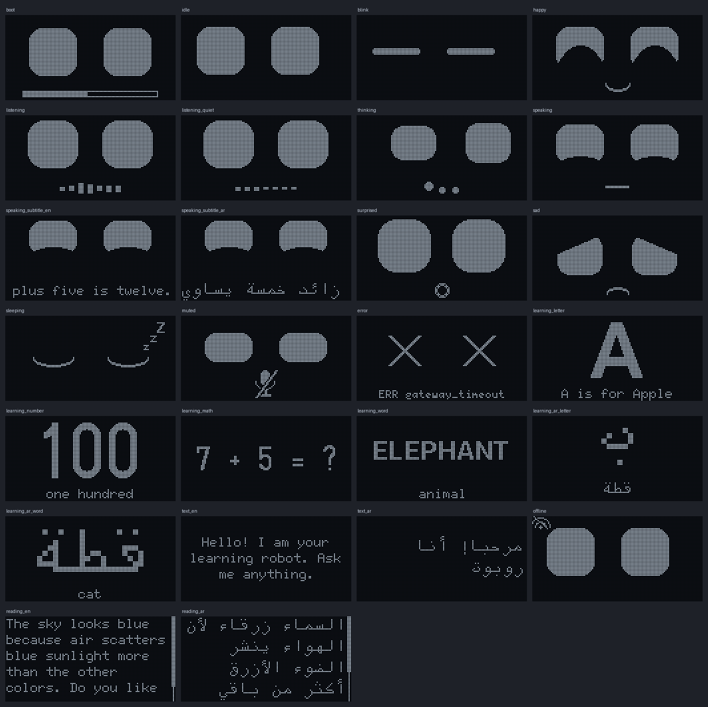

# Educational voice robot — ESP32-S3 N16R8

A standalone, bilingual (Arabic / English) learning robot for children. It listens through an
INMP441 microphone, thinks with a cloud AI gateway, answers through a MAX98357A speaker, and
shows an animated face and learning cards on an SH1106 OLED. **The laptop is only for
development**: in normal use the robot runs on a power bank and talks to the gateway over Wi-Fi.

**New laptop? Start here: [docs/GETTING_STARTED_WINDOWS.md](docs/GETTING_STARTED_WINDOWS.md)**
(download, open in VS Code + PlatformIO, find the COM port, flash and test).

**Talk to Claude (microphone + Wi-Fi, answers on the OLED, no speaker needed):
[docs/CLAUDE_SETUP.md](docs/CLAUDE_SETUP.md)** — accounts, costs, putting the gateway online,
provisioning, first conversation.

Code: https://github.com/gdarkstop-tech/ecu-repot- · branch `claude/vigilant-gauss-lvs43y`



*Frames above are rendered on a PC by the firmware's renderer through the real U8g2 library
(`firmware/sim`). They are not photos of the physical display.*

## Status

| | |
|---|---|
| ✅ Builds | `diag` and `robot` firmware compile for ESP32-S3 N16R8 |
| 🟡 Tested without the physical robot | 73 firmware unit tests, 55 gateway tests, simulator protocol checks, gateway over real HTTP |
| ⬜ Not yet on hardware | Flashing, OLED, audio, Wi-Fi, standalone conversation |

Details and the full checklist: [docs/HARDWARE_VERIFICATION_REPORT.md](docs/HARDWARE_VERIFICATION_REPORT.md).
**The voice AI is not considered complete until a real conversation works through the physical
microphone and speaker with the laptop disconnected (section 7).**

## Repository

```
firmware/        PlatformIO project (ESP32-S3)
  src/diag/        minimal diagnostic firmware (board, flash, PSRAM, I2C, OLED)
  src/app/         the robot firmware
  lib/robot_logic  portable logic: state machine, USB protocol, VAD, conversation, offline tutor
  lib/robot_ui     face + screens renderer (U8g2)
  lib/robot_hw     ESP32 adapters: OLED, button, I2S audio, Wi-Fi, settings, HTTPS client
  test/            host unit tests (pio test -e native)
  sim/             host simulator + image/GIF renderer
gateway/         cloud AI gateway (Python / FastAPI) + Dockerfile
tools/           laptop tools: verify_hardware, robot_console, gateway_client, generators
docs/            ARCHITECTURE, WIRING, PROTOCOL, HARDWARE_VERIFICATION_REPORT, media
```

## 1. Setup on Windows (once)

1. Install **Python 3.11+** from python.org (tick "Add python.exe to PATH").
2. Install the USB driver if Windows doesn't recognise the board: **CP210x** (Silicon Labs) or
   **CH343** (WCH), depending on the chip near the "UART/COM" USB-C port. The native "USB" port needs
   no driver on Windows 10/11.
3. In PowerShell, in this folder:

```powershell
powershell -ExecutionPolicy Bypass -File tools\setup_windows.ps1
```

## 2. Phase 1 — board + OLED test (one command)

Wire the OLED only ([docs/WIRING.md](docs/WIRING.md): VCC→3V3, GND→GND, SDA→GPIO8, SCL→GPIO9),
plug the board in with a **data** USB-C cable, then:

```powershell
.venv\Scripts\python.exe tools\verify_hardware.py
```

It detects the port, reads the chip/flash/PSRAM with esptool, flashes and reads the **diagnostic
firmware**, flashes the **robot firmware**, runs the protocol/state/face checks, asks you to
confirm what you see on the OLED, and writes `reports\verification-hardware-<time>.md`.
Flashing writes the app, bootloader and partition table only; it does not erase NVS settings.
Add `--backup-flash` to save the board's current 16 MB flash first.

Doing it by hand instead:

```powershell
cd firmware
```

```powershell
pio run -e diag -t upload
```

```powershell
pio device monitor
```

```powershell
pio run -e robot -t upload
```

## 3. Phase 2 — microphone and speaker

Wire the INMP441 and MAX98357A ([docs/WIRING.md](docs/WIRING.md)), then:

```powershell
.venv\Scripts\python.exe tools\verify_hardware.py --audio --skip-flash
```

It measures the mic in silence vs. speech, plays a tone, and does a record-and-play-back test.

## 4. Phase 3 — the AI gateway

The gateway runs anywhere with HTTPS. It works **without any API key** in demo mode: deterministic
tutor (letters, counting, math, words, quizzes, stories, life lessons) plus the free eSpeak NG voice.
Speech *recognition* needs a provider; in demo mode the robot honestly says it heard you for N
seconds but cannot understand words yet.

**Register a robot** (prints the token once):

```powershell
cd gateway
```

```powershell
..\.venv\Scripts\python.exe -m robot_gateway.devices add robot-1 --file devices.json
```

**Run locally** (for a first test on your LAN; the robot accepts `http://` only to private IPs):

```powershell
..\.venv\Scripts\python.exe -m uvicorn --factory robot_gateway.app:app_factory --host 0.0.0.0 --port 8080
```

**Deploy** (so the laptop can be off): build the container in `gateway/` on any host with HTTPS —
Google Cloud Run, Fly.io, Render, Railway, or a VPS behind Caddy. Set the variables from
[gateway/.env.example](gateway/.env.example) as environment variables/secrets on the host, run a
**single instance** (state is in memory), and keep `devices.json` or `DEVICE_TOKEN_HASHES` there.

**Providers** are configuration only (no reflashing):

| Setting | Options |
|---|---|
| `LLM_PROVIDER` | `mock` (tutor + demo answers), `anthropic` (Claude, default model `claude-haiku-5-5`, effort `low`), `openai` (ChatGPT or any OpenAI-compatible server) |
| `STT_PROVIDER` | `mock`, `groq` (Whisper Large v3 Turbo, Arabic + English), `openai` (set `STT_MODEL`) |
| `TTS_PROVIDER` | `espeak` (free, robotic), `openai` (`OPENAI_TTS_MODEL`), `mock` (chime) |

Test a deployment from the laptop exactly as the robot would:

```powershell
.venv\Scripts\python.exe tools\gateway_client.py --url https://YOUR-GATEWAY --token rbt_... --text "what is 7 plus 5?"
```

## 5. Provision the robot (over USB, once)

```powershell
.venv\Scripts\python.exe tools\robot_console.py provision
```

Enter the Wi-Fi name/password (2.4 GHz), gateway URL and device token. Secrets are typed hidden,
stored in the robot's flash, and never printed back. Then check with `--skip-flash`:

```powershell
.venv\Scripts\python.exe tools\verify_hardware.py --skip-flash --audio
```

## 6. Using the robot

- **Power on** → boot animation → **muted** (mic off, mic-with-slash face).
- **Short press** the button → unmuted: the robot listens hands-free. Speak; it shows LISTENING
  (bars follow your voice), THINKING (looks up, dots), then SPEAKING (mouth follows the audio, subtitle
  scrolls), then listens again for 8 s before going idle. After 3 minutes idle it sleeps (still wakes on speech).
- **Short press** again → muted. Muting stops the microphone hardware, not just the software.
- Say "let's learn the alphabet", "count with me", "math", "quiz", "tell me a story", "English
  words", "Arabic words", "a life lesson" — or the Arabic equivalents ("علمني الحروف", "قصة", …).
- **No Wi-Fi / gateway down** → offline mode: letter, number and sum cards on the OLED; speaking
  advances the card; **long press** switches activity. The Wi-Fi-off icon shows in the corner.

## 7. Phase 4 — standalone test (the acceptance test)

1. Unplug the USB cable. Power the robot from the JOYROOM power bank.
2. Wait for the face (≈2 s) and for Wi-Fi (the Wi-Fi-off icon disappears).
3. Press the button. Ask in English: "What is seven plus five?" → hear "12", see `7 + 5 = 12`.
4. Ask in Arabic: "كم ثلاثة زائد أربعة؟" → hear the Arabic answer.
5. While it answers, stay silent: it must **not** answer its own voice. Then ask a follow-up within 8 s.
6. Turn the Wi-Fi router off: offline cards appear. Turn it on: conversations resume (≤ 60 s).
7. Record the results in `docs/HARDWARE_VERIFICATION_REPORT.md` (Phase 4).

## 8. Development

```bash
cd firmware && pio test -e native
```

```bash
cd firmware && pio run -e diag -e robot
```

```bash
cd gateway && python -m pytest -q
```

```bash
cd firmware/sim && make gallery
```

```bash
python tools/verify_hardware.py --sim firmware/sim/build/robot_sim --no-confirm
```

Regenerate generated sources: `tools/gen_offline_content.py` (pre-shaped Arabic cards),
`tools/gen_ca_roots.py` (TLS roots from Mozilla's bundle), `tools/gen_contract_fixtures.py`
(real gateway replies for the firmware contract test).

## 9. Troubleshooting

| Symptom | Check |
|---|---|
| Wrong board / ESP32-CAM picked | Unplug the ESP32-CAM-MB, or pass `--port COMx` (`--list-ports` shows each port's chip) |
| No COM port | Data cable (not charge-only); other USB-C port; CP210x/CH343 driver; BOOT+RESET to force download mode |
| Upload fails "Failed to connect" | Close serial monitors; hold BOOT while upload starts |
| OLED not found at 0x3C/0x3D | VCC on 3V3, SDA/SCL not swapped (8 = SDA, 9 = SCL), module is the 4-pin I2C version |
| Picture shifted 2 px / noisy column | Module is SSD1306: `set oled_driver ssd1306` in the console, then `reboot` |
| PSRAM test fails / size 0 | Board is not N16R8, or `memory_type` changed in `platformio.ini` |
| `mic_test` all_zero | INMP441 wiring (SCK 5, WS 6, SD 7, L/R→GND); try `set mic_channel right` + reboot |
| Robot answers itself | Speaker facing the mic; lower `volume`; increase distance |
| Resets when speaking | Power bank / cable current; lower volume; capacitor on amp VIN |
| `auth_rejected` on the face | Token wrong/revoked: provision `device_token` again |
| `net_or_tls_error` | Gateway URL/HTTPS; if your host's certificate uses another root CA, add it in `tools/gen_ca_roots.py` |

Camera (not implemented yet): [docs/CAMERA_PLAN.md](docs/CAMERA_PLAN.md) ·
Architecture and security: [docs/ARCHITECTURE.md](docs/ARCHITECTURE.md) · Protocols:
[docs/PROTOCOL.md](docs/PROTOCOL.md) · Wiring: [docs/WIRING.md](docs/WIRING.md)
