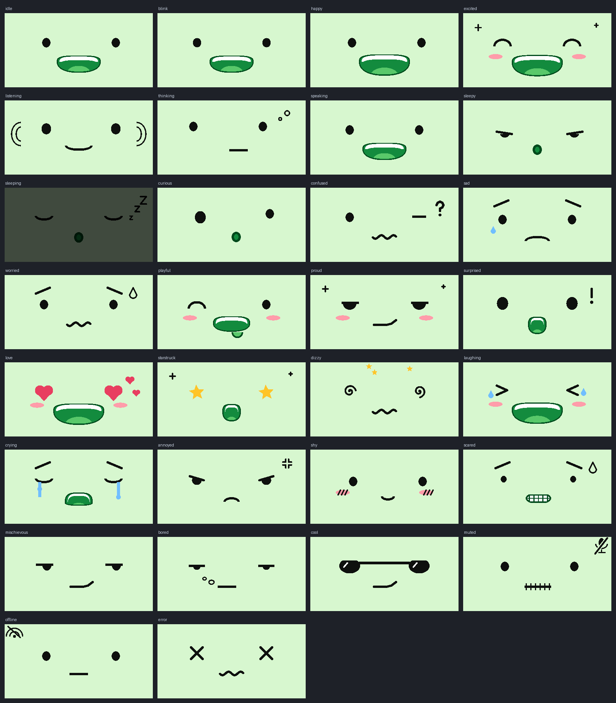

# The face — BMO (firmware 0.6.0)

The robot is dressed as BMO (Adventure Time), so its screen is BMO's face: **round dot eyes and a
wide open mouth — dark-green lip, green inside, white teeth under the top lip, a light-green
tongue** — on BMO's mint-green screen. The drawings are original geometry measured from the
show's proportions (eyes at ~27 % / 73 % of the width, mouth corners at ~66 % of the height); no
artwork is copied.



## Important: the green screen needs a colour display

The SH1106 on the robot today is a **one-colour** OLED (white, or blue/yellow depending on the
module): it cannot show green. The same drawing code therefore runs in two ways:

| Display | What you see |
|---|---|
| **SH1106 (now)** | The faces above in black on a lit screen; green parts become black, the tongue and blush become a fine dot pattern, the teeth stay lit. |
| **Colour display (upgrade)** | Exactly the colour pictures above — BMO's mint screen, green mouth, white teeth, pink blush, red hearts, gold stars. |


*All frames are rendered on a PC by the firmware's own code (`firmware/sim`; mono through the
real U8g2 library). They are not photos of the physical display. Animated versions:
`docs/media/<name>.gif` (SH1106) and `docs/media/<name>_color.gif` (colour).*

Two ways to get the green look:

1. **Cheapest:** a mint-green transparent film (or a green acrylic window in BMO's body) over a
   **white** SH1106. The lit screen then glows green and the features stay dark — close to BMO.
2. **Real colours:** a colour SPI TFT, e.g. a 1.9" 170×320 ST7789 (its shape is close to BMO's
   face). The code is ready: the painter draws at any scale (`FacePainter(surface, 2.5)`), and the
   colours are already defined (`bmoColor`, `toRgb565`). What is still needed: the TFT driver
   `Surface` (a few lines), wiring to free SPI pins, and testing on the board. **Not done yet,
   because no colour display is connected.**

## Expressions (31)

| Face | Design | Shown when |
|---|---|---|
| idle | dot eyes, open mouth with teeth and tongue; eyes drift a little, blink every 3–5 s | resting |
| blink | eyes become short lines for ~0.2 s (sometimes twice) | naturally, and to hide every change of face |
| happy | bigger open grin | learning cards, answers, after a story |
| excited | `^ ^` eyes, big grin, blush, twinkling sparkles, a gentle bounce | every 5th right answer in a row |
| listening | slightly bigger eyes, sound waves that follow the microphone | capturing speech |
| thinking | eyes up-left, small mouth to the side, thought bubbles | waiting for the gateway |
| speaking | the mouth opens in 4 steps with the voice; **keeps the reply mood's eyes** (laughing eyes while saying "ha ha ha") | the voice is playing |
| sleepy | heavy lids, small yawn | the model's free quota is used up |
| sleeping | closed eyes, Zz, the screen dims | 3 minutes without activity |
| curious | one big eye, one raised eye, small "o" | "I don't know" during practice |
| confused | dot + squint, wavy mouth, "?" | not a number when it asked for one |
| sad | lowered eyes, worried brows, frown, a tear | camera questions, model errors |
| worried | brows, wavy mouth, sweat drop | a wrong practice answer; distress words |
| playful | wink, tongue out, blush | right word out of order; "wink" |
| proud | half-lidded eyes, smirk, blush, sparkles | a right practice answer; "you're smart" |
| surprised | big eyes, round open mouth, "!" | demo mode |
| **love** | beating **heart eyes**, big grin, blush, little hearts floating up | "I love you" / "بحبك" |
| **starstruck** | spinning **star eyes**, open "wow" mouth, sparkles | "make star eyes" |
| **dizzy** | turning **spiral eyes**, wobbly mouth, stars circling the head | "make a dizzy face" / "اعمل وش دايخ" |
| **laughing** | `> <` eyes, big grin, tears of joy, bouncing | "ha ha", "tickle", "make a laughing face", "اضحك" |
| **crying** | closed eyes, wailing mouth, **tear streams** | "I hate you" / "بكرهك", "cry" / "عيط" |
| **annoyed** | grumpy slanted lids, pout, anger mark 💢 | rude words: "stupid", "shut up", "يا غبي", "اسكت" |
| **shy** | looks down and aside, tiny smile, blush with `///` | "you're cute" / "انت حلو" |
| **scared** | small eyes, clenched teeth, sweat drop, **trembling** | "boo!" / "بخ" |
| **mischievous** | side-eye under half lids, smirk | "make a sneaky face" / "اعمل وش شقي" |
| **bored** | `-_-` eyes, flat mouth to the side, a sigh puff | "this is boring" / "زهقت" |
| **cool** | **sunglasses** with a glint, smirk | "be cool" / "خليك روش", "you're awesome" |
| muted | calm eyes, zipped mouth, mic-off icon | microphone muted (power-on default) |
| offline | eyes down, flat mouth, Wi-Fi-off icon | no Wi-Fi / gateway |
| error | `x x` eyes, wavy mouth, short code | errors |
| boot | dot → scan line → face opens its eyes, loading blocks | power-on (2.2 s) |

## What the robot reacts to

The gateway reacts at once, **without calling the AI model** (fixed word lists, so it costs none
of the free quota), and the face stays ~4 s after it speaks:

| The child says | Face | The robot says (short) |
|---|---|---|
| "make a laughing face", "show me your sad face", "be cool", "laugh", "wink" | that face | "Ha ha ha! This is my laughing face!" |
| "اعمل وش زعلان", "وريني وشك الخايف", "خليك روش", "اضحك", "عيط", "اغمز" | that face | "ها ها ها! هذا وجهي الضاحك!" |
| "make a face" / "اعمل وش" | excited | lists the faces it can make |
| a rude word: "stupid", "idiot", "ugly", "يا غبي", "انت حمار", "اسكت" | annoyed | "Hmph! That's not a nice word. I have feelings too!" |
| "I hate you" / "بكرهك" | crying | "Waaah! But I like you!" |
| "I'm stupid" / "انا غبي" (about themselves) | love | "Don't say that about yourself! You are smart." |
| "I love you" / "بحبك", "you're my best friend" | love | "Aww! I love you too!" |
| "you're cute" / "انت حلو" | shy | "Oh! You're making me blush!" |
| "you're awesome" / "انت روش" | cool | "Thanks! I am pretty cool, aren't I?" |
| "you're smart", "good robot" / "انت شاطر" | proud | "Thank you! You are smart too!" |
| "ha ha ha" / "ههههه", "tickle" / "زغزغ" | laughing | "Your laugh makes me laugh too!" |
| "boo!" / "بخ" | scared | "Aaah! You scared me!" |
| "this is boring" / "زهقت" | bored | offers a quiz, a story or a math game |

Rules that keep it sensible: a practice answer is never taken as a reaction, and a reaction
never skips the practice item (the robot keeps waiting for it); words like "ugly" or "وحش" only
count when aimed at the robot ("you're ugly", "انت وحش") — "the ugly duckling" or "a story about
a monster" are not insults; safety checks (distress, personal data, unsafe topics) always come
first; when the child starts talking, the reaction face gives way to the listening face at once.

## Text on the face

- **With a speaker** (the BMO robot): the face does the talking — no subtitles and no full-screen
  text. Learning cards (a big letter, number, sum or word) still appear because they are the
  lesson. If the voice cannot be played, the face looks worried and shows the short English
  answer as one line; Arabic text is not shown (it looks spaced out on this OLED).
- **Without a speaker** (`speaker off`): answers scroll as text.

## Animation rules

Soft and stable: blinks from a seeded schedule (2.8–5.2 s apart, 1 in 6 a double blink); the eyes
drift through a small fixed pattern (±2 px), eased; every change of face happens behind a blink;
the talking mouth uses a smoothed level with 4 shapes held ≥ 70 ms; hearts beat, stars twinkle,
spirals turn, the scared face trembles by 1 px and the laughing face bobs by 1.5 px. All of this
is unit-tested (`firmware/test/test_face_model`).

## Settings

- `set screen light` (default): lit screen, dark features — the BMO look.
- `set screen dark`: dark screen, lit features (less light in a dark room).

## Code structure

```
lib/robot_logic/src/face_model.*   WHAT: one FacePose per frame (eye kinds, mouth kind, marks,
                                   offsets, blink, mouth opening, the reply mood) — no pixels
lib/robot_logic/src/face_canvas.*  HOW: draws a pose as semantic tones (screen, ink, lip, mouth,
                                   teeth, tongue, blush, heart, star, tear...) on any Surface, at
                                   any scale; bmoColor() = BMO's palette. Portable and unit-tested
lib/robot_ui/src/face_renderer.*   the SH1106 Surface (tones -> lit / dark / dithered pixels),
                                   light/dark screen, learning cards, text
gateway/robot_gateway/reactions.py the reactions and face commands (EN + AR word lists)
```

A colour display only needs a `Surface` that writes RGB565 pixels and a scale factor; the face
model, animation, painter and tests stay as they are.

## Try it

- On the robot: USB console `selftest` (33 steps, every face), or one face: `face love`.
- Talk to it: "make a dizzy face", "اعمل وش مكسوف", "boo!", "you're awesome".
- On the PC: `cd firmware/sim && make gallery` renders every face (mono and colour) to `docs/media`.
