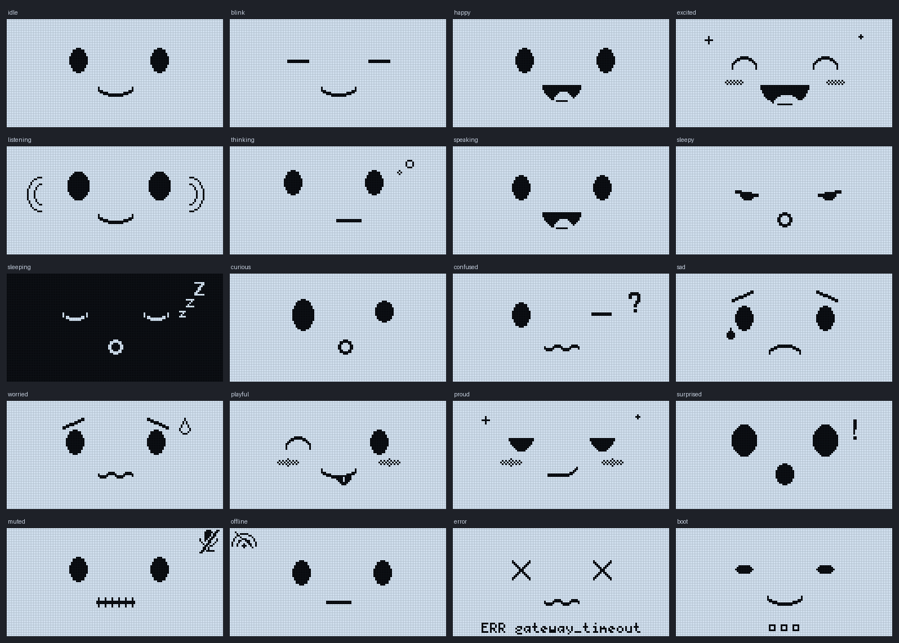

# The face — BMO-inspired, monochrome (firmware 0.5.0)

The robot is dressed as BMO (Adventure Time), so its OLED is BMO's screen: a **light screen with
small dark dot eyes and a simple mouth**. The SH1106 is a 128×64 one-colour display, so the style
is built from black/white shapes only: oval dot eyes, line and "D" mouths, a few small marks
(blush, sweat drop, "?", Zz) and calm animation. The drawings are original pixel geometry made
for this robot; no artwork from the show is copied.



*Rendered on a PC by the firmware's renderer through the real U8g2 library (`firmware/sim`),
1:1 with what the SH1106 shows — not photos. Animated versions: `docs/media/<name>.gif`.*

## Expressions

| Face | Design | Shown when |
|---|---|---|
| idle | two oval dot eyes, soft smile; eyes drift a little, blink every 3–5 s | resting, unmuted |
| blink | eyes become short lines for ~0.2 s (sometimes twice) | naturally, on the button, and to hide every change of expression |
| happy | dot eyes, open "D" smile | learning cards, LLM answers, after a story |
| excited | `^ ^` eyes, big grin, blush, twinkling sparkles, a gentle 1 px bounce | every 5th right answer in a row |
| listening | slightly bigger eyes, sound-wave arcs on both sides that follow the microphone | capturing speech |
| thinking | eyes look up-left, small mouth to the side, thought bubbles appear one by one | waiting for the gateway |
| speaking | dot eyes, mouth opens in 4 steps with the speech level (each step held ≥ 70 ms) | the voice is playing |
| sleepy | heavy lids, small yawn | the model's free quota is used up ("my brain needs a break") |
| sleeping | relaxed closed eyes, Zz rising, the **screen turns dark** | 3 minutes without activity |
| curious | one big eye, one small raised eye, small "o" | "I don't know" during practice (it tells the answer) |
| confused | one dot eye, one squint, wavy mouth, "?" | not a number when it asked for one |
| sad | lowered eyes, worried brows, frown, a tear | camera questions, model errors |
| worried | worried brows, wavy mouth, sweat drop | a wrong practice answer; the voice failed; distress words |
| playful | wink + tongue out, blush | right word but out of order ("let's go in order!") |
| proud | flat-lidded eyes, smirk, blush, sparkles | a right practice answer |
| surprised | big round eyes, round mouth, "!" | demo mode |
| muted | calm eyes, **zipped mouth**, mic-off icon | microphone muted (power-on default) |
| offline | eyes look down, flat mouth, Wi-Fi-off icon | resting without Wi-Fi / gateway |
| error | `x x` eyes, wavy mouth, short code (e.g. `ERR auth_rejected`) | errors |
| boot | dot → scan line → screen opens → face opens its eyes, 3 loading blocks | power-on (2.2 s) |

The gateway chooses the reply mood (`emotion`): happy, sad, surprised, idle, thinking, excited,
proud, worried, curious, confused, playful, sleepy. System faces (speaking, listening, muted,
offline, error, sleeping) are decided by the robot only.

## Text on the face

- **With a speaker** (the BMO robot): the face does the talking — **no subtitles and no
  full-screen text**. Learning cards (a big letter, number, sum or word with a one-line caption)
  still appear because they are the lesson. If the voice cannot be played (e.g. Groq's daily voice
  quota), the face looks worried and shows the short English answer as a one-line label; **Arabic
  text is not shown** (U8g2's 16 px Arabic font with pre-shaped letters looks spaced out on this
  OLED), the face and the next question carry the conversation instead.
- **Without a speaker** (`speaker off`): answers still scroll as text, because that is the only
  way such a robot can answer.

## Animation rules

Soft and stable, never random-looking: blinks come from a seeded schedule (2.8–5.2 s apart,
1 in 6 a double blink); the eyes drift through a fixed, small pattern (±2 px) with eased
movement — under a pixel per frame; posture changes glide over ~90 ms; every expression change
happens behind a blink; the talking mouth uses a smoothed level with 4 shapes. All of this is
unit-tested (`firmware/test/test_face_model`).

## Settings

- `set screen light` (default): lit screen, dark features — the BMO look.
- `set screen dark`: dark screen, lit features (less light; useful in a dark room).

The screen is lit while the robot is awake, so an OLED ages evenly; it turns dark while sleeping.

## Code structure (ready for a colour display)

```
lib/robot_logic/src/face_model.*   WHAT: one FacePose per frame (eye kinds, mouth kind, marks,
                                   offsets, blink, mouth opening) — no pixels, unit-tested
lib/robot_ui/src/face_painter.*    HOW on the SH1106: shapes with U8g2, colour ROLES
lib/robot_ui/src/face_renderer.*   screens (face, cards, text), light/dark screen
```

Colours are semantic roles — `Screen`, `Feature`, `Accent` — never pixel values. The mono
painter maps them to lit / dark / 50 % dither. A colour display (e.g. a 240×135 TFT) only needs a
new painter: map `Screen` to BMO's teal, `Feature` to its dark green, `Accent` to a soft pink
for blush and tongue, and scale `FaceLayout`. The face model, animation and tests stay as they are.

## Try it

- Every face on the robot: USB console `selftest` (22 steps), or one face: `face playful`.
- On the PC: `cd firmware/sim && make gallery` renders all faces to `docs/media`.
